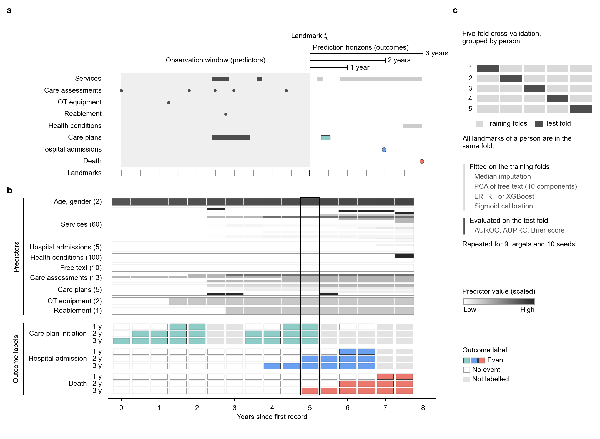

# socialcare

Code for **Anticipating health and care trajectories from routinely collected
social care records**, *npj Health Systems* 3, 78 (2026).
[doi:10.1038/s44401-026-00139-3](https://doi.org/10.1038/s44401-026-00139-3)

We used local authority adult social care records to predict three outcomes
over the next 1, 2 and 3 years: starting a new long-term care plan, hospital
admission, and death. A prediction is made every six months for each person,
using everything recorded up to that date.



**From social care records to model input.** **a**, Records of one synthetic
person across the seven data domains. Predictions are made at landmarks every
6 months. At a landmark *t*<sub>0</sub>, everything recorded up to *t*<sub>0</sub>
(grey band) is summarised into predictors, and the first care plan initiation,
hospital admission and death in the following 1, 2 and 3 years give the outcome
labels (coloured). Other records after *t*<sub>0</sub> are shown in light grey;
open circles are hospital stays of 3 days or less, which are not counted.
**b**, The same person's landmarks as model input, one column per landmark on
the time axis of **a**; the boxed column is *t*<sub>0</sub>. Predictors are
scaled to 0–1 for display, and those that are zero at every landmark of this
person are not drawn. An outcome label is missing when follow-up ends before
the horizon, when death comes before a care plan or admission, or when the
landmark falls inside an active care plan or hospital stay. **c**, Five-fold
cross-validation grouped by person. Preprocessing, model fitting and
calibration use the training folds only; performance is measured on the
held-out fold. Outcome colours match the paper. A vector version is in
`docs/pipeline.pdf`, and both are drawn by `python docs/make_pipeline_figure.py`.

## Data

The study used pseudonymised records from Oxfordshire County Council. They
cannot be shared publicly but may be available on reasonable request, subject
to the council's approval. This repository includes a generator for **random
synthetic data** with the same tables and columns, so the code can be run end
to end. Results on synthetic data have no relation to those in the paper.

## Getting started

Python 3.10 or later.

```bash
git clone https://github.com/guxiao0822/socialcare.git
cd socialcare
pip install -e .          # or: pip install -r requirements.txt && pip install -e .
bash run_demo.sh          # about 2 minutes on a laptop
```

`run_demo.sh` runs these three steps:

```bash
# 1. synthetic workbook (8 sheets) + random text embeddings
python scripts/generate_synthetic_data.py --n-people 1000 --out-dir data/synthetic

# 2. one row per person per landmark: predictors and outcome labels
python scripts/build_dataset.py \
    --data data/synthetic/social_care_synthetic.xlsx \
    --embeddings data/synthetic/other_condition_embeddings.pkl \
    --out data/synthetic/landmarks.pkl

# 3. cross-validated models and metrics
python scripts/train_evaluate.py --data data/synthetic/landmarks.pkl --out-dir results/synthetic
```

Results go to `results/synthetic/summary.csv`, which holds the mean (SD) of
AUROC, AUPRC, accuracy, F1, Brier score and log loss for each target.

### Running it as in the paper

```bash
python scripts/embed_other_conditions.py --conditions unique_conditions.txt \
    --out other_condition_embeddings.pkl        # needs: pip install -e ".[embeddings]"
python scripts/build_dataset.py --data <workbook>.xlsx \
    --embeddings other_condition_embeddings.pkl --out landmarks.pkl
python scripts/train_evaluate.py --data landmarks.pkl --out-dir results \
    --models xgb rf lr --seeds 42 7 13 21 37 101 123 2023 2024 2025 --device cuda --shap
```

Logistic regression is slow on the full data. Expect hours, not minutes.

## Repository layout

```
socialcare/            the analysis code
  config.py            dates, horizons, category lists
  cohort.py            exclusions and 6-monthly landmarks
  targets.py           1/2/3-year outcome labels
  features.py          the 198 predictors
  modelling.py         preprocessing, models, calibration, metrics, SHAP
  synthetic.py         synthetic data generator
scripts/               command-line entry points, run in the order above
docs/
  data_format.md       input tables, predictor list and outcome definitions
  pipeline.pdf, .png   the figure above (183 mm wide, Arial; vector PDF)
run_demo.sh
```

## Methods in brief

Details are in the paper and in [docs/data_format.md](docs/data_format.md).

- **Cohort.** Adults (18 or over at first record) with at least one record
  besides demographics.
- **Landmarks.** Every 6 months from a person's first record until death or
  1 May 2024.
- **Predictors.** Only records dated on or before the landmark are used.
- **Outcomes.** For care plans and admissions, death before the event is
  treated as censoring.
- **Validation.** 5-fold cross-validation grouped by person, so no one appears
  in both training and test folds.
- **Preprocessing.** Imputation and PCA of the text embeddings are fitted on
  the training folds only.
- **Models.** Logistic regression (elastic net), random forest and XGBoost,
  with fixed hyperparameters (no tuning). Each is followed by Platt (sigmoid)
  calibration fitted on the training folds.
- **Seeds.** `GroupKFold` does not shuffle, so the fold split is the same for
  every seed. Seeds change only the models' own randomness.

The code here gives the same predictions as the code used for the paper. We
checked this on synthetic data: identical landmark tables and identical
cross-validated predictions.

## Citation

```bibtex
@article{gu2026anticipating,
  title   = {Anticipating health and care trajectories from routinely collected social care records},
  author  = {Gu, Xiao and Nourse, Rebecca and Lu, Lei and Smout, Emily and Fuller, Karen and
             Havord, Fiona and Baran, Victoria and Briggs, Adam and Clifton, Lei and
             Farmer, Andrew and Clifton, David A.},
  journal = {npj Health Systems},
  volume  = {3},
  pages   = {78},
  year    = {2026},
  doi     = {10.1038/s44401-026-00139-3}
}
```

## License

MIT, see [LICENSE](LICENSE).
